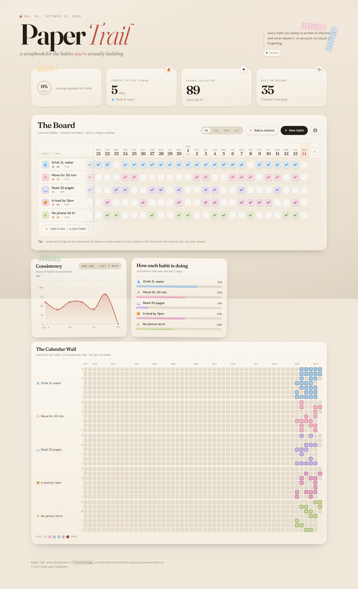

# Paper Trail

A scrapbook-style habit tracker. Rows are habits, columns are days, and every box you stamp
updates a live progress chart. No account, no server, no dependencies.



## Run it

Open `index.html` in a browser. That's it — it works straight off the filesystem.

To serve it instead:

```bash
python -m http.server 8777
# then visit http://localhost:8777/
```

## What it does

**Add a row (a habit)** — the `+ New habit` button, or `+ Add a row` at the bottom of the
board. Pick a name, an emoji sticker and one of eight colours.

**Add a column (a day)** — the `+ Add a column` button, or the `＋` pinned to the right edge
of the board. Choose any date, or use the quick chips (tomorrow / next week / in a month /
yesterday). Future dates are dimmed so you can plan ahead and are excluded from your stats.

**Stamp the boxes** — click a box to toggle it, or press and drag across a range to stamp a
whole week at once. Dragging paints whatever value you started on, so you can sweep a range
on or off. Keyboard works too: tab to a box and press <kbd>Enter</kbd> or <kbd>Space</kbd>.

**Charts** — all three update as soon as you mark a box:

| Chart | What it shows |
| --- | --- |
| Consistency | Area/line chart of the share of habits stamped per day, with a hover tooltip listing every habit for that day |
| How each habit is doing | Per-habit completion rate as a coloured bar |
| The Calendar Wall | A contribution-style calendar — one block per habit, one square per day, coloured by that habit |

Use the `7d / 14d / 30d / all` switcher to change the window. The Calendar Wall sizes itself
to fill the card (up to a full year of weeks).

## Your data never gets forgotten

Everything is written to `localStorage` on every single edit, under the key
`papertrail.habits.v1`. Nothing is sent anywhere — there is no server and no network call.

That covers normal use, but `localStorage` is tied to one browser profile on one machine, so
clearing site data would wipe it. The database icon in the toolbar (bottom right of the
board) lets you:

- **Download backup (.json)** — a plain-text snapshot of every habit and stamp. Keep it in
  Drive/Dropbox/email and your history is safe indefinitely.
- **Restore from backup** — reads one back and replaces the current book (asks first).
- **Load demo data** — a throwaway example book with generated history.
- **Erase everything** — wipes it, behind a double confirmation.

A backup round-trips exactly: the export and a re-import produce identical data.

## Design notes

The look is built around the "clean girl" / scrapbook-journal aesthetic that dominates
Instagram mood boards and Pinterest planners:

- Oat-paper background with an SVG `feTurbulence` grain and a soft vignette
- Editorial serif display type (Fraunces) against a clean sans (DM Sans)
- Washi-tape accents and slightly rotated, taped-down cards
- Checkboxes that "stamp" in with a small overshoot animation
- A tray of eight muted washer colours assigned per habit

### Files

```
index.html   markup and structure
styles.css   all styling
app.js       state, persistence, grid, charts (~800 lines, no dependencies)
```

Google Fonts are loaded from a CDN, with full system-font fallbacks if you're offline.
